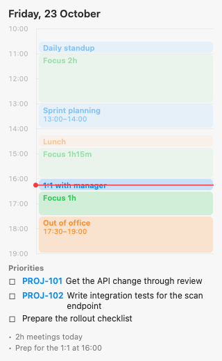
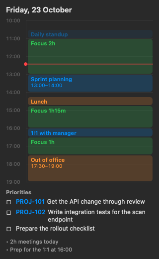

# DailyPlan

A tiny native macOS menu bar widget that shows today's plan as a vertical timeline:
meetings, focus blocks, lunch, and your top priorities. The plan is generated every
weekday morning by a [Claude](https://claude.com) scheduled task from Google Calendar and Jira.

<p>
  
  
</p>

## Features

- **Menu bar title** shows the next meeting: `13:45 Daily Scrum`, then `25m Daily Scrum` within the hour, and `● Daily Scrum` while it's running.
- **Left-click** opens the timeline in a popover. **Right-click** opens a menu: pin it as a floating panel, keep the panel always on top, reload, open `plan.json`, quit.
- **Timeline**:
  - Meetings are blue; click one to open its Meet link. Overlapping meetings are shown side by side.
  - Free gaps of an hour or more show as green focus blocks.
  - Lunch and personal blocks are orange.
  - A red line marks the current time, and past items fade out.
- **Priorities**: click ☐ to check one off (stored in `done.json`), or click the ticket key to open it.
- One Swift file with no dependencies. Follows light and dark mode. Redraws every 30 s and reloads `plan.json` whenever it changes.

## Install

Requires macOS 13+ and the Xcode Command Line Tools (`xcode-select --install`).

```bash
git clone git@github.com:MaltsevaNata/daily-plan-widget.git
cd daily-plan-widget
./install.sh
```

`install.sh` builds the binary into `~/.daily-plan/DailyPlan` and registers a LaunchAgent so it starts at login. Run it again after editing `DailyPlan.swift`.

To try it right away with sample data:

```bash
cp examples/plan.example.json ~/.daily-plan/plan.json
```

## Generating the plan with Claude

The widget only reads `~/.daily-plan/plan.json`; anything can write it. The intended setup is a
Claude desktop app scheduled task:

1. Connect the **Google Calendar** and **Atlassian (Jira)** connectors.
2. Create a scheduled task with cron `0 9,13 * * 1-5` (weekdays 09:00 and 13:00).
3. Use [`prompts/daily-plan-refresh.md`](prompts/daily-plan-refresh.md) as its prompt, after filling in the `<PLACEHOLDERS>` (name, email, timezone, lunch time, Atlassian cloud ID).

The 09:00 run builds the plan. The 13:00 run refreshes meetings but keeps priorities, so your checkmarks survive.
Each previous day's plan is archived to `~/.daily-plan/history/`.

## plan.json format

```json
{
  "date": "2026-10-26",
  "generatedAt": "2026-10-26T09:00:00+04:00",
  "events": [
    {"start": "13:00", "end": "14:00", "title": "Sprint planning", "url": "https://meet.google.com/..."},
    {"start": "14:15", "end": "14:45", "title": "Lunch", "url": null, "kind": "lunch"}
  ],
  "priorities": [
    {"title": "Get the API change through review", "ref": "PROJ-101", "url": "https://..."}
  ],
  "notes": ["2h meetings today"]
}
```

| Field | Meaning |
|---|---|
| `events[].kind` | Omit for meetings. `lunch` or `personal` are drawn in orange and never show in the menu bar countdown |
| `priorities[].ref` | Optional ticket key, drawn as a link to `url` |
| `notes` | Short lines under the priorities. Lines starting with "Focus block" are hidden because the timeline already shows them |

See [`examples/plan.example.json`](examples/plan.example.json) for a full example.

## Previewing without the UI

```bash
~/.daily-plan/DailyPlan --snapshot preview.png          # light
~/.daily-plan/DailyPlan --snapshot preview.png dark     # dark
DAILY_PLAN_FILE=examples/plan.example.json ~/.daily-plan/DailyPlan --snapshot preview.png
```

## Uninstall

```bash
launchctl bootout gui/$(id -u)/com.$(id -un).dailyplan
rm ~/Library/LaunchAgents/com.$(id -un).dailyplan.plist
rm -rf ~/.daily-plan
```

## License

[MIT](LICENSE)
